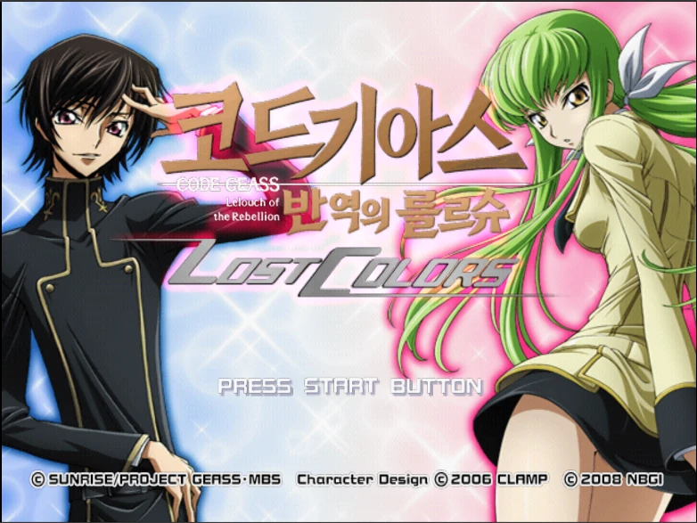

# 코드 기아스 반역의 를르슈 LOST COLORS 한국어 패치 (Code Geass LOST COLORS Korean Patch)



PS2 일본판 『コードギアス 反逆のルルーシュ LOST COLORS』용 비공식 한국어 번역 패치입니다.
게임 ISO는 배포하지 않으며, 본인이 가진 원본 ISO에 적용하는 차분 패치만 제공합니다.

## 👉 [패치 페이지에서 한글판 만들기](https://melonoolong.github.io/Code_Geass_LC_KR_Patch/)

**PS2 원본 ISO만 넣으면 기본판, PSP 원본 ISO도 함께 넣으면 합본판(일본해방전선편 + 편의 기능)을 브라우저에서 바로 만듭니다.**
xdelta 프로그램으로 직접 적용하려면 [Releases](../../releases)의 xdelta 파일을 쓰세요(기본판만).

> ⚠️ **패치는 반드시 아무것도 적용하지 않은 원본 ISO에 적용하세요.**

> **여러 루트를 엔딩까지 플레이하며 검수했지만, 모든 분기와 이벤트를 확인한 것은 아닙니다.**
> 오역, 어색한 문구, 칸을 넘는 UI 등이 남아 있을 수 있습니다.

## 기본판과 합본판

| 판 | 내용 | 만드는 방법 |
|---|---|---|
| 기본판 | PS2판 전체 한국어 (원판과 같은 조작) | xdelta 패치 또는 [패치 페이지](https://melonoolong.github.io/Code_Geass_LC_KR_Patch/) |
| 합본판 | 기본판 + PSP판에만 있는 일본해방전선편 + 편의 기능 | [패치 페이지](https://melonoolong.github.io/Code_Geass_LC_KR_Patch/) (PSP 원본 ISO 필요) |

합본판은 일본해방전선편 자료를 플레이어의 PSP ISO에서 직접 만들기 때문에 패치 페이지에서만 만들 수 있습니다. 패치 페이지는 브라우저 안에서만 처리하며, 파일은 어디로도 올라가지 않습니다.

## 지원 원본

### PS2 (필수)

| 항목 | 값 |
|---|---|
| 게임 | コードギアス 反逆のルルーシュ LOST COLORS (일본판, SLPS-25860, v1.01) |
| 파일 | 원본 ISO 이미지 1개 |
| 크기 | 4,237,066,240 바이트 |
| CRC32 | `55E55C72` |
| MD5 | `6ae394a497d4cd3d962021fb46ffa443` |
| SHA-1 | `23c166b0e3b9e23528c38e52f4ef9a9175987664` |
| SHA-256 | `6032a1cdf02b4b5aac63ebed67571a2434f033dce005d8e7e3e6016a1b2bee54` |

v2.00(4,243,488,768 바이트)에는 적용되지 않습니다. 해시가 다르면 패치가 적용되지 않거나 결과가 달라집니다.

### PSP (합본판만)

| 판 | 크기 | SHA-256 |
|---|---|---|
| ULJS-00135 v1.01 | 913,670,144 바이트 | `2fff44d387c88c7243eba66c433afa2fa29d24e9b3a4347c48de4a8a41ae27ce` |
| ULJS-00135 v2.00 | 916,750,336 바이트 | `384f06770832130bbea375da019bb09033d16efc7049afb0ce0a4cf0a3050e58` |

두 판 모두 같은 결과가 나옵니다.

## 패치 파일

| 파일 | 크기 | SHA-256 |
|---|---|---|
| `CodeGeass_LostColors_KR_v0.7.0.xdelta` | 30,119,915 바이트 | `72726ed954df0c729ffebf99eb7aabc88d61baae8ad5a91ff9e3ddd5834c8e10` |

[Releases](../../releases)에서 받을 수 있습니다. (기본판)

## 적용 방법

### 패치 페이지 (기본판·합본판)
1. [패치 페이지](https://melonoolong.github.io/Code_Geass_LC_KR_Patch/)를 엽니다. PC의 Chrome이나 Edge를 권장합니다.
2. PS2 원본 ISO를 넣습니다. 합본판을 만들려면 PSP 원본 ISO도 넣습니다.
3. 합본판은 「일본해방전선편 엔딩 영상도 넣기」를 고를 수 있습니다. PSP ISO의 엔딩 영상을 변환해서 넣으며 PC에서 몇 분 걸립니다. 넣지 않으면 같은 곡의 흑의 기사단편 엔딩 화면이 대신 나오고, 타이틀 로고가 「COMPLETE ver.」(소문자)로 표시됩니다.
4. 「한글판 만들기」를 누르고 저장할 곳을 고릅니다. 마지막에 「완성했습니다」가 뜨면 결과 해시까지 확인된 것입니다.

### xdelta UI / Delta Patcher (기본판, Windows)
1. `CodeGeass_LostColors_KR_v0.7.0.xdelta`를 받습니다.
2. xdelta UI 또는 Delta Patcher에서 **Patch**에 xdelta 파일, **Source**에 원본 ISO를 지정합니다.
3. 결과 파일 이름을 정하고 적용합니다.

### xdelta3 명령줄 (기본판)
```
xdelta3 -d -s 원본.iso CodeGeass_LostColors_KR_v0.7.0.xdelta 결과.iso
```

### 적용 결과 확인

| 결과 | 크기 | CRC32 | SHA-256 |
|---|---|---|---|
| 기본판 | 4,426,145,792 바이트 | `E27AEC31` | `fe676e7b134b66ca11871c045fd8320bee82698c036ea4f90e46842cf1570537` |
| 합본판 | 4,507,557,888 바이트 | `F4EE8B7D` | `acd4dba3b5579d2791c94035548a456cc995a74ca1e71638e48851ff38e014d4` |
| 합본판 (엔딩 영상 포함) | 4,507,557,888 바이트 | `02F95370` | `13b4f24011c7ba57678efe5ba74fec4413bbde535e0d3a43e056e93063112fce` |

## 현재 상태 (v0.7.0)

- 대사·선택지·메뉴·시어터 등 게임 안 문장 전체를 한국어로 표시합니다.
- 타이틀 로고, 배경화면, 지도·달력, 알림 등 그림 속 글자도 한글로 바꿨습니다.
- 이벤트 영상과 오프닝·엔딩에 한국어 자막을 넣었습니다. 영상은 원본 그대로 두고 자막만 덧그립니다.
- 원판에서 글자 없이 나오는 음성(전투 중 음성, 타이틀 미니드라마, 시어터·설정 화면 음성)에도 자막을 넣었습니다.
- 편의 기능 (**합본판에만 들어 있습니다.** 기본판은 원판과 같습니다)
  - 본 적 있는 이벤트에서 START를 누르면 이벤트를 통째로 건너뜁니다.
  - R2는 빨리감기입니다. 읽지 않은 대사도 넘깁니다.
  - L1 오토 메시지: 원판은 CONFIG의 오토 메시지 설정이 켜져 있을 때만 L1이 듣습니다(기본은 꺼짐). 합본판은 설정과 상관없이 L1로 켜고 끕니다.
  - 이미 고른 선택지는 파란색으로 표시합니다. 앞 분기가 다르면 따로 기록합니다.
  - 게임 오버가 되면 타이틀로 돌아가지 않고 그날 장면을 다시 시작할 수 있습니다.
- 한글 표시와 위 기능을 위해 게임 실행 파일과 글꼴 자료 일부를 수정했습니다.
- 확인 환경: PCSX2 에뮬레이터.

### 알아 둘 것
- 합본판에서 만든 세이브 중 일본해방전선편을 진행하던 세이브와, 해방전선편 CG·대사를 넣은 시어터 작품은 기본판이나 원판에서 열지 마세요. 게임이 멈출 수 있습니다. 반대로 기본판·원판의 세이브는 합본판에서 그대로 쓸 수 있습니다.
- 타이틀 화면의 자막은 캐릭터끼리 대화하는 미니드라마에만 나옵니다. 제목만 읽는 타이틀 콜에는 자막이 없습니다.
- 게임 CONFIG의 화면 설정이 4:3이면 장면이 가운데 띠에 그려지고 위아래에 배경화면이 나옵니다(원판과 같음). 16:9로 두고 에뮬레이터도 16:9로 하면 화면이 꽉 찹니다.

문제를 발견하면 Issues에 장면, 스크린샷, 사용한 에뮬레이터(또는 실기)를 함께 알려 주세요.

## 변경 이력

### v0.7.0 (2026-11-21)
- 첫 공개 릴리스.

## 글꼴

이 패치는 글꼴 파일을 담지 않고, 아래 글꼴로 미리 그린 글자 그림만 게임 자료에 넣었습니다.

| 쓰인 곳 | 글꼴 | 라이선스 |
|---|---|---|
| 대사·메뉴 글자, 그림 속 글자, 영상·음성 자막 | Noto Sans KR | [SIL OFL 1.1](licenses/OFL-NotoSansKR.txt) |

「경고」 그림 글자는 궁서체로 그린 정지 그림이며 글꼴 파일은 들어 있지 않습니다.

## 면책

- 이 프로젝트는 팬 번역이며 선라이즈, 반다이 남코와 관련이 없습니다.
- コードギアス(Code Geass)와 관련 상표·저작물의 권리는 각 권리자에게 있습니다.
- 게임 ISO, BIOS, 원본 데이터는 제공하지 않습니다. 본인이 소유한 원본으로만 사용해 주세요.
- 무료 배포입니다. 패치한 ISO를 사고팔거나 다른 곳에 올려 두지 마세요.
- 패치 사용으로 생긴 문제에 대해 책임지지 않습니다.
